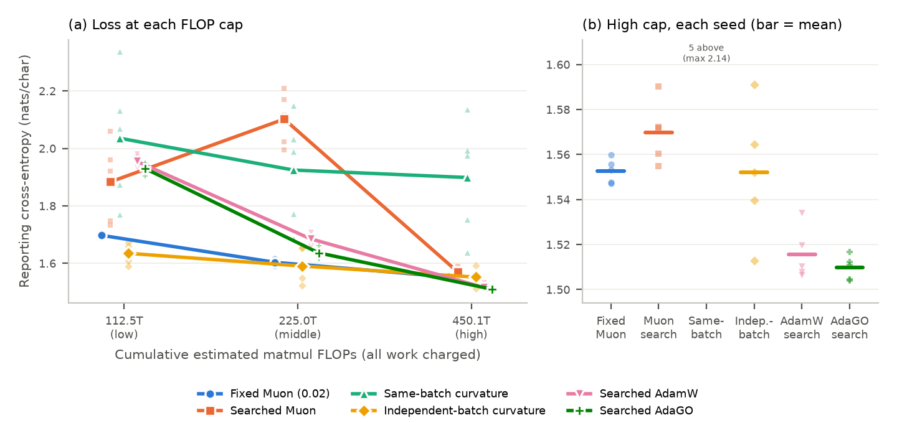
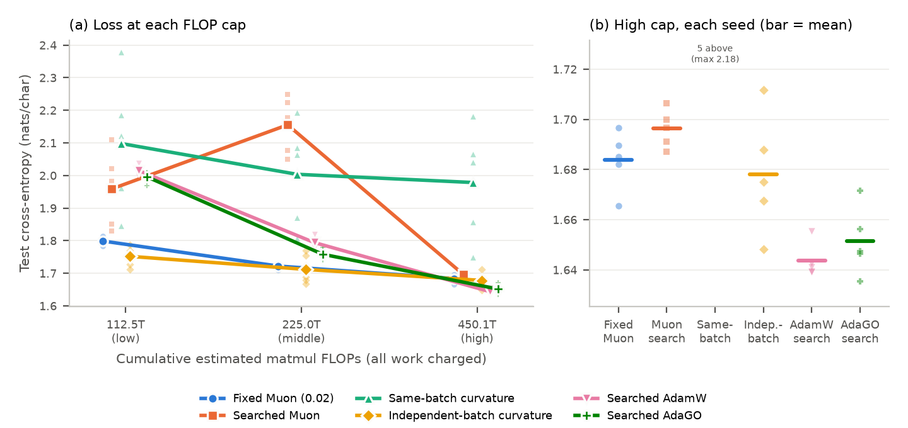

# 5090 production results

Protocol: [docs/5090-overnight-experiment-plan.md](../../docs/5090-overnight-experiment-plan.md), frozen in [configs/production.json](../../configs/production.json). Model: 9,724,288-parameter NanoGPT ([configs/wide.json](../../configs/wide.json)), Tiny Shakespeare characters, FP32 (TF32 off), RTX 5090. Paired seeds: 3, 4, 5, 6, 7. Loss = cross-entropy in nats per character on the reporting half of validation (the tuning half only selects search candidates). Paired differences are method minus comparator (negative favours the method), mean ± SD over seeds, two-sided paired t-test.

## Main comparison: reporting loss at each FLOP cap

| Arm | low cap | middle cap | high cap |
|---|---:|---:|---:|
| Fixed Muon (0.02) | 1.6974 ± 0.0056 (n=5) | 1.6035 ± 0.0100 (n=5) | 1.5527 ± 0.0054 (n=5) |
| Searched Muon | 1.8837 ± 0.1410 (n=5) | 2.1020 ± 0.0920 (n=5) | 1.5699 ± 0.0136 (n=5) |
| Same-batch curvature | 2.0355 ± 0.2225 (n=5) | 1.9247 ± 0.1911 (n=5) | 1.8987 ± 0.2001 (n=5) |
| Independent-batch curvature | 1.6348 ± 0.0341 (n=5) | 1.5905 ± 0.0605 (n=5) | 1.5520 ± 0.0290 (n=5) |
| Searched AdamW | 1.9547 ± 0.0202 (n=5) | 1.6853 ± 0.0199 (n=5) | 1.5157 ± 0.0116 (n=5) |
| Searched AdaGO | 1.9299 ± 0.0184 (n=5) | 1.6363 ± 0.0201 (n=5) | 1.5097 ± 0.0053 (n=5) |

(a) Faint points are individual seeds; lines join per-cap means, placed at each cap's mean actual FLOPs and dodged horizontally by up to ±9% for legibility (actual FLOPs differ by under 0.1% between arms; see the compute table). (b) The high cap only, zoomed; values above the panel are counted at its top edge.

### Paired reporting-loss differences

| Method − comparator | low cap | middle cap | high cap |
|---|---|---|---|
| Independent-batch curvature − Searched Muon | -0.2489 ± 0.1409 (5/5 seeds lower, p=0.017) | -0.5115 ± 0.0957 (5/5 seeds lower, p=0.000) | -0.0179 ± 0.0260 (4/5 seeds lower, p=0.199) |
| Independent-batch curvature − Fixed Muon (0.02) | -0.0627 ± 0.0377 (5/5 seeds lower, p=0.021) | -0.0130 ± 0.0664 (3/5 seeds lower, p=0.685) | -0.0007 ± 0.0307 (3/5 seeds lower, p=0.961) |
| Independent-batch curvature − Same-batch curvature | -0.4007 ± 0.2449 (5/5 seeds lower, p=0.022) | -0.3342 ± 0.1778 (5/5 seeds lower, p=0.014) | -0.3467 ± 0.2073 (5/5 seeds lower, p=0.020) |
| Same-batch curvature − Searched Muon | +0.1518 ± 0.2941 (2/5 seeds lower, p=0.313) | -0.1772 ± 0.2148 (4/5 seeds lower, p=0.139) | +0.3288 ± 0.2086 (0/5 seeds lower, p=0.024) |
| Same-batch curvature − Fixed Muon (0.02) | +0.3381 ± 0.2174 (0/5 seeds lower, p=0.025) | +0.3212 ± 0.1879 (0/5 seeds lower, p=0.019) | +0.3460 ± 0.1993 (0/5 seeds lower, p=0.018) |
| Searched Muon − Fixed Muon (0.02) | +0.1863 ± 0.1404 (0/5 seeds lower, p=0.041) | +0.4985 ± 0.0962 (0/5 seeds lower, p=0.000) | +0.0172 ± 0.0129 (0/5 seeds lower, p=0.041) |
| Independent-batch curvature − Searched AdamW | -0.3200 ± 0.0261 (5/5 seeds lower, p=0.000) | -0.0948 ± 0.0712 (5/5 seeds lower, p=0.041) | +0.0363 ± 0.0391 (1/5 seeds lower, p=0.107) |
| Independent-batch curvature − Searched AdaGO | -0.2951 ± 0.0283 (5/5 seeds lower, p=0.000) | -0.0458 ± 0.0637 (3/5 seeds lower, p=0.183) | +0.0422 ± 0.0316 (0/5 seeds lower, p=0.040) |

### Compute and runtime (means over seeds)

| Arm | Cap | Actual FLOPs | Unused FLOPs | Selected-trajectory updates | Training characters (incl. discarded trials) | Work s | Elapsed s | Peak alloc MB |
|---|---|---:|---:|---:|---:|---:|---:|---:|
| Fixed Muon (0.02) | low | 1.1254e+14 | 0.000e+00 | 500 | 1,024,000 | 10.3 | 11.0 | 629 |
| Fixed Muon (0.02) | middle | 2.2508e+14 | 0.000e+00 | 1000 | 2,048,000 | 20.6 | 21.8 | 629 |
| Fixed Muon (0.02) | high | 4.5016e+14 | 0.000e+00 | 2000 | 4,096,000 | 40.9 | 42.3 | 629 |
| Searched Muon | low | 1.1243e+14 | 1.146e+11 | 339 | 997,376 | 9.5 | 9.9 | 887 |
| Searched Muon | middle | 2.2497e+14 | 1.146e+11 | 679 | 2,021,376 | 20.5 | 21.0 | 877 |
| Searched Muon | high | 4.5005e+14 | 1.146e+11 | 1359 | 4,069,376 | 40.8 | 41.4 | 870 |
| Same-batch curvature | low | 1.1241e+14 | 1.314e+11 | 495 | 1,013,760 | 9.7 | 9.8 | 612 |
| Same-batch curvature | middle | 2.2507e+14 | 1.420e+10 | 990 | 2,027,520 | 19.3 | 19.6 | 612 |
| Same-batch curvature | high | 4.5016e+14 | 4.967e+09 | 1979 | 4,052,992 | 38.7 | 39.2 | 612 |
| Independent-batch curvature | low | 1.1250e+14 | 3.763e+10 | 491 | 1,005,568 | 9.7 | 9.8 | 651 |
| Independent-batch curvature | middle | 2.2505e+14 | 2.840e+10 | 980 | 2,007,040 | 19.3 | 19.6 | 651 |
| Independent-batch curvature | high | 4.5015e+14 | 9.935e+09 | 1958 | 4,009,984 | 38.6 | 39.0 | 651 |
| Searched AdamW | low | 1.1251e+14 | 2.997e+10 | 614 | 1,806,336 | 6.4 | 6.8 | 1052 |
| Searched AdamW | middle | 2.2507e+14 | 1.071e+10 | 1227 | 3,659,776 | 12.3 | 12.8 | 1052 |
| Searched AdamW | high | 4.5006e+14 | 9.657e+10 | 2456 | 7,364,608 | 24.1 | 24.7 | 1069 |
| Searched AdaGO | low | 1.1243e+14 | 1.146e+11 | 339 | 997,376 | 9.9 | 10.3 | 859 |
| Searched AdaGO | middle | 2.2497e+14 | 1.146e+11 | 679 | 2,021,376 | 21.7 | 22.2 | 876 |
| Searched AdaGO | high | 4.5005e+14 | 1.146e+11 | 1359 | 4,069,376 | 40.5 | 41.1 | 876 |

Single-trajectory arms report work/elapsed time up to each cap; search arms report the whole campaign for that cap. Reporting evaluation, checkpoint saves, the mechanism check and the isolation check are off-budget (not in FLOPs or work time).

### Failures and ineligible points

- none

## Search outcomes

| Arm | Seed | Cap | Tuning loss per candidate (rate: loss @ updates) | Selected | Edge |
|---|---|---|---|---|---|
| Searched AdaGO | 3 | low | [0.02, 0.0001]: 2.528 @ 37; [0.05, 0.0005]: 2.524 @ 37; [0.1, 0.0005]: 2.529 @ 37; [0.3, 0.0005]: 2.588 @ 37; [0.3, 0.003]: 2.588 @ 37 | [0.05, 0.0005] | no |
| Searched AdaGO | 3 | middle | [0.02, 0.0001]: 2.471 @ 77; [0.05, 0.0005]: 2.447 @ 77; [0.1, 0.0005]: 2.411 @ 77; [0.3, 0.0005]: 2.461 @ 77; [0.3, 0.003]: 2.461 @ 77 | [0.1, 0.0005] | no |
| Searched AdaGO | 3 | high | [0.02, 0.0001]: 2.402 @ 157; [0.05, 0.0005]: 2.244 @ 157; [0.1, 0.0005]: 2.169 @ 157; [0.3, 0.0005]: 2.148 @ 157; [0.3, 0.003]: 2.148 @ 157 | [0.3, 0.003] | yes |
| Searched AdaGO | 4 | low | [0.02, 0.0001]: 2.538 @ 37; [0.05, 0.0005]: 2.536 @ 37; [0.1, 0.0005]: 2.549 @ 37; [0.3, 0.0005]: 2.608 @ 37; [0.3, 0.003]: 2.608 @ 37 | [0.05, 0.0005] | no |
| Searched AdaGO | 4 | middle | [0.02, 0.0001]: 2.490 @ 77; [0.05, 0.0005]: 2.467 @ 77; [0.1, 0.0005]: 2.457 @ 77; [0.3, 0.0005]: 2.503 @ 77; [0.3, 0.003]: 2.503 @ 77 | [0.1, 0.0005] | no |
| Searched AdaGO | 4 | high | [0.02, 0.0001]: 2.416 @ 157; [0.05, 0.0005]: 2.247 @ 157; [0.1, 0.0005]: 2.178 @ 157; [0.3, 0.0005]: 2.176 @ 157; [0.3, 0.003]: 2.176 @ 157 | [0.3, 0.003] | yes |
| Searched AdaGO | 5 | low | [0.02, 0.0001]: 2.544 @ 37; [0.05, 0.0005]: 2.535 @ 37; [0.1, 0.0005]: 2.539 @ 37; [0.3, 0.0005]: 2.597 @ 37; [0.3, 0.003]: 2.597 @ 37 | [0.05, 0.0005] | no |
| Searched AdaGO | 5 | middle | [0.02, 0.0001]: 2.495 @ 77; [0.05, 0.0005]: 2.481 @ 77; [0.1, 0.0005]: 2.440 @ 77; [0.3, 0.0005]: 2.493 @ 77; [0.3, 0.003]: 2.493 @ 77 | [0.1, 0.0005] | no |
| Searched AdaGO | 5 | high | [0.02, 0.0001]: 2.424 @ 157; [0.05, 0.0005]: 2.308 @ 157; [0.1, 0.0005]: 2.181 @ 157; [0.3, 0.0005]: 2.191 @ 157; [0.3, 0.003]: 2.191 @ 157 | [0.1, 0.0005] | no |
| Searched AdaGO | 6 | low | [0.02, 0.0001]: 2.545 @ 37; [0.05, 0.0005]: 2.540 @ 37; [0.1, 0.0005]: 2.548 @ 37; [0.3, 0.0005]: 2.583 @ 37; [0.3, 0.003]: 2.583 @ 37 | [0.05, 0.0005] | no |
| Searched AdaGO | 6 | middle | [0.02, 0.0001]: 2.492 @ 77; [0.05, 0.0005]: 2.476 @ 77; [0.1, 0.0005]: 2.457 @ 77; [0.3, 0.0005]: 2.422 @ 77; [0.3, 0.003]: 2.422 @ 77 | [0.3, 0.0005] | yes |
| Searched AdaGO | 6 | high | [0.02, 0.0001]: 2.424 @ 157; [0.05, 0.0005]: 2.291 @ 157; [0.1, 0.0005]: 2.187 @ 157; [0.3, 0.0005]: 2.162 @ 157; [0.3, 0.003]: 2.162 @ 157 | [0.3, 0.003] | yes |
| Searched AdaGO | 7 | low | [0.02, 0.0001]: 2.536 @ 37; [0.05, 0.0005]: 2.531 @ 37; [0.1, 0.0005]: 2.543 @ 37; [0.3, 0.0005]: 2.566 @ 37; [0.3, 0.003]: 2.566 @ 37 | [0.05, 0.0005] | no |
| Searched AdaGO | 7 | middle | [0.02, 0.0001]: 2.515 @ 77; [0.05, 0.0005]: 2.503 @ 77; [0.1, 0.0005]: 2.483 @ 77; [0.3, 0.0005]: 2.401 @ 77; [0.3, 0.003]: 2.401 @ 77 | [0.3, 0.0005] | yes |
| Searched AdaGO | 7 | high | [0.02, 0.0001]: 2.416 @ 157; [0.05, 0.0005]: 2.283 @ 157; [0.1, 0.0005]: 2.165 @ 157; [0.3, 0.0005]: 2.154 @ 157; [0.3, 0.003]: 2.154 @ 157 | [0.3, 0.003] | yes |
| Searched AdaGO, extended grid (follow-up) | 3 | low | [0.3, 0.003]: 2.588 @ 37; [0.5, 0.003]: 2.601 @ 37; [1.0, 0.003]: 2.622 @ 37; [0.5, 0.01]: 2.601 @ 37; [1.0, 0.01]: 2.622 @ 37 | [0.3, 0.003] | yes |
| Searched AdaGO, extended grid (follow-up) | 3 | middle | [0.3, 0.003]: 2.461 @ 77; [0.5, 0.003]: 2.484 @ 77; [1.0, 0.003]: 2.535 @ 77; [0.5, 0.01]: 2.484 @ 77; [1.0, 0.01]: 2.535 @ 77 | [0.3, 0.003] | yes |
| Searched AdaGO, extended grid (follow-up) | 3 | high | [0.3, 0.003]: 2.148 @ 157; [0.5, 0.003]: 2.182 @ 157; [1.0, 0.003]: 2.489 @ 157; [0.5, 0.01]: 2.180 @ 157; [1.0, 0.01]: 2.489 @ 157 | [0.3, 0.003] | yes |
| Searched AdaGO, extended grid (follow-up) | 4 | low | [0.3, 0.003]: 2.608 @ 37; [0.5, 0.003]: 2.610 @ 37; [1.0, 0.003]: 2.617 @ 37; [0.5, 0.01]: 2.611 @ 37; [1.0, 0.01]: 2.617 @ 37 | [0.3, 0.003] | yes |
| Searched AdaGO, extended grid (follow-up) | 4 | middle | [0.3, 0.003]: 2.503 @ 77; [0.5, 0.003]: 2.525 @ 77; [1.0, 0.003]: 2.542 @ 77; [0.5, 0.01]: 2.525 @ 77; [1.0, 0.01]: 2.542 @ 77 | [0.3, 0.003] | yes |
| Searched AdaGO, extended grid (follow-up) | 4 | high | [0.3, 0.003]: 2.176 @ 157; [0.5, 0.003]: 2.212 @ 157; [1.0, 0.003]: 2.483 @ 157; [0.5, 0.01]: 2.202 @ 157; [1.0, 0.01]: 2.481 @ 157 | [0.3, 0.003] | yes |
| Searched AdaGO, extended grid (follow-up) | 5 | low | [0.3, 0.003]: 2.597 @ 37; [0.5, 0.003]: 2.602 @ 37; [1.0, 0.003]: 2.617 @ 37; [0.5, 0.01]: 2.602 @ 37; [1.0, 0.01]: 2.617 @ 37 | [0.3, 0.003] | yes |
| Searched AdaGO, extended grid (follow-up) | 5 | middle | [0.3, 0.003]: 2.493 @ 77; [0.5, 0.003]: 2.503 @ 77; [1.0, 0.003]: 2.542 @ 77; [0.5, 0.01]: 2.504 @ 77; [1.0, 0.01]: 2.542 @ 77 | [0.3, 0.003] | yes |
| Searched AdaGO, extended grid (follow-up) | 5 | high | [0.3, 0.003]: 2.191 @ 157; [0.5, 0.003]: 2.183 @ 157; [1.0, 0.003]: 2.501 @ 157; [0.5, 0.01]: 2.185 @ 157; [1.0, 0.01]: 2.498 @ 157 | [0.5, 0.003] | no |
| Searched AdaGO, extended grid (follow-up) | 6 | low | [0.3, 0.003]: 2.583 @ 37; [0.5, 0.003]: 2.614 @ 37; [1.0, 0.003]: 2.636 @ 37; [0.5, 0.01]: 2.614 @ 37; [1.0, 0.01]: 2.636 @ 37 | [0.3, 0.003] | yes |
| Searched AdaGO, extended grid (follow-up) | 6 | middle | [0.3, 0.003]: 2.422 @ 77; [0.5, 0.003]: 2.510 @ 77; [1.0, 0.003]: 2.548 @ 77; [0.5, 0.01]: 2.510 @ 77; [1.0, 0.01]: 2.548 @ 77 | [0.3, 0.003] | yes |
| Searched AdaGO, extended grid (follow-up) | 6 | high | [0.3, 0.003]: 2.162 @ 157; [0.5, 0.003]: 2.225 @ 157; [1.0, 0.003]: 2.506 @ 157; [0.5, 0.01]: 2.224 @ 157; [1.0, 0.01]: 2.504 @ 157 | [0.3, 0.003] | yes |
| Searched AdaGO, extended grid (follow-up) | 7 | low | [0.3, 0.003]: 2.566 @ 37; [0.5, 0.003]: 2.582 @ 37; [1.0, 0.003]: 2.613 @ 37; [0.5, 0.01]: 2.582 @ 37; [1.0, 0.01]: 2.613 @ 37 | [0.3, 0.003] | yes |
| Searched AdaGO, extended grid (follow-up) | 7 | middle | [0.3, 0.003]: 2.401 @ 77; [0.5, 0.003]: 2.393 @ 77; [1.0, 0.003]: 2.567 @ 77; [0.5, 0.01]: 2.392 @ 77; [1.0, 0.01]: 2.567 @ 77 | [0.5, 0.01] | no |
| Searched AdaGO, extended grid (follow-up) | 7 | high | [0.3, 0.003]: 2.154 @ 157; [0.5, 0.003]: 2.150 @ 157; [1.0, 0.003]: 2.458 @ 157; [0.5, 0.01]: 2.145 @ 157; [1.0, 0.01]: 2.452 @ 157 | [0.5, 0.01] | no |
| Searched AdamW | 3 | low | 0.0003: 2.600 @ 67; 0.001: 3.312 @ 67; 0.003: 3.116 @ 67; 0.006: 3.155 @ 67; 0.01: 3.364 @ 67 | 0.0003 | yes |
| Searched AdamW | 3 | middle | 0.0003: 2.503 @ 140; 0.001: 2.769 @ 140; 0.003: 2.769 @ 140; 0.006: 2.935 @ 140; 0.01: 3.180 @ 140 | 0.0003 | yes |
| Searched AdamW | 3 | high | 0.0003: 2.339 @ 285; 0.001: 2.551 @ 285; 0.003: 2.631 @ 285; 0.006: 2.758 @ 285; 0.01: 2.890 @ 285 | 0.0003 | yes |
| Searched AdamW | 4 | low | 0.0003: 2.641 @ 67; 0.001: 3.227 @ 67; 0.003: 3.003 @ 67; 0.006: 3.057 @ 67; 0.01: 3.234 @ 67 | 0.0003 | yes |
| Searched AdamW | 4 | middle | 0.0003: 2.515 @ 140; 0.001: 2.748 @ 140; 0.003: 2.835 @ 140; 0.006: 2.924 @ 140; 0.01: 3.088 @ 140 | 0.0003 | yes |
| Searched AdamW | 4 | high | 0.0003: 2.349 @ 285; 0.001: 2.537 @ 285; 0.003: 2.656 @ 285; 0.006: 2.750 @ 285; 0.01: 2.878 @ 285 | 0.0003 | yes |
| Searched AdamW | 5 | low | 0.0003: 2.613 @ 67; 0.001: 3.166 @ 67; 0.003: 2.963 @ 67; 0.006: 3.166 @ 67; 0.01: 3.147 @ 67 | 0.0003 | yes |
| Searched AdamW | 5 | middle | 0.0003: 2.494 @ 140; 0.001: 2.721 @ 140; 0.003: 2.751 @ 140; 0.006: 2.947 @ 140; 0.01: 3.024 @ 140 | 0.0003 | yes |
| Searched AdamW | 5 | high | 0.0003: 2.332 @ 285; 0.001: 2.535 @ 285; 0.003: 2.631 @ 285; 0.006: 2.809 @ 285; 0.01: 2.833 @ 285 | 0.0003 | yes |
| Searched AdamW | 6 | low | 0.0003: 2.665 @ 67; 0.001: 3.342 @ 67; 0.003: 3.036 @ 67; 0.006: 3.171 @ 67; 0.01: 3.284 @ 67 | 0.0003 | yes |
| Searched AdamW | 6 | middle | 0.0003: 2.524 @ 140; 0.001: 2.941 @ 140; 0.003: 2.752 @ 140; 0.006: 2.960 @ 140; 0.01: 3.140 @ 140 | 0.0003 | yes |
| Searched AdamW | 6 | high | 0.0003: 2.359 @ 285; 0.001: 2.530 @ 285; 0.003: 2.619 @ 285; 0.006: 2.727 @ 285; 0.01: 2.832 @ 285 | 0.0003 | yes |
| Searched AdamW | 7 | low | 0.0003: 2.692 @ 67; 0.001: 3.326 @ 67; 0.003: 3.345 @ 67; 0.006: 3.369 @ 67; 0.01: 3.388 @ 67 | 0.0003 | yes |
| Searched AdamW | 7 | middle | 0.0003: 2.517 @ 140; 0.001: 2.785 @ 140; 0.003: 2.792 @ 140; 0.006: 2.965 @ 140; 0.01: 3.135 @ 140 | 0.0003 | yes |
| Searched AdamW | 7 | high | 0.0003: 2.349 @ 285; 0.001: 2.548 @ 285; 0.003: 2.634 @ 285; 0.006: 2.770 @ 285; 0.01: 2.851 @ 285 | 0.0003 | yes |
| Searched AdamW, extended grid (follow-up) | 3 | low | 3e-05: 2.640 @ 67; 5e-05: 2.583 @ 67; 0.0001: 2.541 @ 67; 0.0002: 2.561 @ 67; 0.0003: 2.600 @ 67 | 0.0001 | no |
| Searched AdamW, extended grid (follow-up) | 3 | middle | 3e-05: 2.557 @ 140; 5e-05: 2.532 @ 140; 0.0001: 2.499 @ 140; 0.0002: 2.494 @ 140; 0.0003: 2.503 @ 140 | 0.0002 | no |
| Searched AdamW, extended grid (follow-up) | 3 | high | 3e-05: 2.492 @ 285; 5e-05: 2.452 @ 285; 0.0001: 2.394 @ 285; 0.0002: 2.362 @ 285; 0.0003: 2.339 @ 285 | 0.0003 | yes |
| Searched AdamW, extended grid (follow-up) | 4 | low | 3e-05: 2.642 @ 67; 5e-05: 2.591 @ 67; 0.0001: 2.557 @ 67; 0.0002: 2.579 @ 67; 0.0003: 2.641 @ 67 | 0.0001 | no |
| Searched AdamW, extended grid (follow-up) | 4 | middle | 3e-05: 2.551 @ 140; 5e-05: 2.523 @ 140; 0.0001: 2.495 @ 140; 0.0002: 2.507 @ 140; 0.0003: 2.515 @ 140 | 0.0001 | no |
| Searched AdamW, extended grid (follow-up) | 4 | high | 3e-05: 2.495 @ 285; 5e-05: 2.452 @ 285; 0.0001: 2.397 @ 285; 0.0002: 2.370 @ 285; 0.0003: 2.349 @ 285 | 0.0003 | yes |
| Searched AdamW, extended grid (follow-up) | 5 | low | 3e-05: 2.647 @ 67; 5e-05: 2.600 @ 67; 0.0001: 2.554 @ 67; 0.0002: 2.549 @ 67; 0.0003: 2.613 @ 67 | 0.0002 | no |
| Searched AdamW, extended grid (follow-up) | 5 | middle | 3e-05: 2.555 @ 140; 5e-05: 2.522 @ 140; 0.0001: 2.493 @ 140; 0.0002: 2.474 @ 140; 0.0003: 2.494 @ 140 | 0.0002 | no |
| Searched AdamW, extended grid (follow-up) | 5 | high | 3e-05: 2.490 @ 285; 5e-05: 2.449 @ 285; 0.0001: 2.379 @ 285; 0.0002: 2.341 @ 285; 0.0003: 2.332 @ 285 | 0.0003 | yes |
| Searched AdamW, extended grid (follow-up) | 6 | low | 3e-05: 2.635 @ 67; 5e-05: 2.591 @ 67; 0.0001: 2.562 @ 67; 0.0002: 2.590 @ 67; 0.0003: 2.665 @ 67 | 0.0001 | no |
| Searched AdamW, extended grid (follow-up) | 6 | middle | 3e-05: 2.552 @ 140; 5e-05: 2.527 @ 140; 0.0001: 2.496 @ 140; 0.0002: 2.499 @ 140; 0.0003: 2.524 @ 140 | 0.0001 | no |
| Searched AdamW, extended grid (follow-up) | 6 | high | 3e-05: 2.483 @ 285; 5e-05: 2.440 @ 285; 0.0001: 2.382 @ 285; 0.0002: 2.359 @ 285; 0.0003: 2.359 @ 285 | 0.0002 | no |
| Searched AdamW, extended grid (follow-up) | 7 | low | 3e-05: 2.643 @ 67; 5e-05: 2.597 @ 67; 0.0001: 2.562 @ 67; 0.0002: 2.611 @ 67; 0.0003: 2.692 @ 67 | 0.0001 | no |
| Searched AdamW, extended grid (follow-up) | 7 | middle | 3e-05: 2.556 @ 140; 5e-05: 2.529 @ 140; 0.0001: 2.493 @ 140; 0.0002: 2.501 @ 140; 0.0003: 2.517 @ 140 | 0.0001 | no |
| Searched AdamW, extended grid (follow-up) | 7 | high | 3e-05: 2.487 @ 285; 5e-05: 2.445 @ 285; 0.0001: 2.382 @ 285; 0.0002: 2.355 @ 285; 0.0003: 2.349 @ 285 | 0.0003 | yes |
| Searched Muon | 3 | low | 0.003: 2.530 @ 37; 0.01: 2.507 @ 37; 0.02: 2.503 @ 37; 0.04: 2.448 @ 37; 0.08: 2.571 @ 37 | 0.04 | no |
| Searched Muon | 3 | middle | 0.003: 2.449 @ 77; 0.01: 2.266 @ 77; 0.02: 2.201 @ 77; 0.04: 2.160 @ 77; 0.08: 2.445 @ 77 | 0.04 | no |
| Searched Muon | 3 | high | 0.003: 2.229 @ 157; 0.01: 2.087 @ 157; 0.02: 2.018 @ 157; 0.04: 2.074 @ 157; 0.08: 2.431 @ 157 | 0.02 | no |
| Searched Muon | 4 | low | 0.003: 2.540 @ 37; 0.01: 2.518 @ 37; 0.02: 2.507 @ 37; 0.04: 2.493 @ 37; 0.08: 2.566 @ 37 | 0.04 | no |
| Searched Muon | 4 | middle | 0.003: 2.468 @ 77; 0.01: 2.294 @ 77; 0.02: 2.218 @ 77; 0.04: 2.200 @ 77; 0.08: 2.516 @ 77 | 0.04 | no |
| Searched Muon | 4 | high | 0.003: 2.245 @ 157; 0.01: 2.081 @ 157; 0.02: 1.988 @ 157; 0.04: 2.060 @ 157; 0.08: 2.556 @ 157 | 0.02 | no |
| Searched Muon | 5 | low | 0.003: 2.537 @ 37; 0.01: 2.504 @ 37; 0.02: 2.484 @ 37; 0.04: 2.494 @ 37; 0.08: 2.531 @ 37 | 0.02 | no |
| Searched Muon | 5 | middle | 0.003: 2.476 @ 77; 0.01: 2.326 @ 77; 0.02: 2.232 @ 77; 0.04: 2.226 @ 77; 0.08: 2.525 @ 77 | 0.04 | no |
| Searched Muon | 5 | high | 0.003: 2.297 @ 157; 0.01: 2.071 @ 157; 0.02: 1.982 @ 157; 0.04: 2.092 @ 157; 0.08: 2.546 @ 157 | 0.02 | no |
| Searched Muon | 6 | low | 0.003: 2.545 @ 37; 0.01: 2.518 @ 37; 0.02: 2.492 @ 37; 0.04: 2.507 @ 37; 0.08: 2.549 @ 37 | 0.02 | no |
| Searched Muon | 6 | middle | 0.003: 2.473 @ 77; 0.01: 2.322 @ 77; 0.02: 2.245 @ 77; 0.04: 2.214 @ 77; 0.08: 2.479 @ 77 | 0.04 | no |
| Searched Muon | 6 | high | 0.003: 2.271 @ 157; 0.01: 2.085 @ 157; 0.02: 2.017 @ 157; 0.04: 2.095 @ 157; 0.08: 2.472 @ 157 | 0.02 | no |
| Searched Muon | 7 | low | 0.003: 2.540 @ 37; 0.01: 2.510 @ 37; 0.02: 2.495 @ 37; 0.04: 2.483 @ 37; 0.08: 2.547 @ 37 | 0.04 | no |
| Searched Muon | 7 | middle | 0.003: 2.483 @ 77; 0.01: 2.337 @ 77; 0.02: 2.243 @ 77; 0.04: 2.204 @ 77; 0.08: 2.487 @ 77 | 0.04 | no |
| Searched Muon | 7 | high | 0.003: 2.274 @ 157; 0.01: 2.068 @ 157; 0.02: 2.003 @ 157; 0.04: 2.070 @ 157; 0.08: 2.459 @ 157 | 0.02 | no |

## Probe activity on the single trajectories (whole high-cap run)

| Arm | Seed | Probes | Invalid | Clamped | Probe time / ordinary training time | Final LR |
|---|---|---:|---:|---:|---:|---:|
| Backtracking, fixed 0.02 proposal | 3 | 37 | 0 | 0 | 2.6% | 0 |
| Backtracking, fixed 0.02 proposal | 4 | 37 | 0 | 0 | 2.5% | 0.005 |
| Backtracking, fixed 0.02 proposal | 5 | 37 | 0 | 0 | 2.5% | 0.02 |
| Backtracking, fixed 0.02 proposal | 6 | 37 | 0 | 0 | 2.5% | 0.02 |
| Backtracking, fixed 0.02 proposal | 7 | 37 | 0 | 0 | 2.5% | 0.02 |
| Independent + backtracking | 3 | 37 | 2 | 0 | 2.5% | 0 |
| Independent + backtracking | 4 | 37 | 1 | 0 | 2.5% | 0.02134 |
| Independent + backtracking | 5 | 37 | 4 | 0 | 2.5% | 0.02 |
| Independent + backtracking | 6 | 37 | 0 | 0 | 2.4% | 0.02408 |
| Independent + backtracking | 7 | 37 | 2 | 0 | 2.5% | 0 |
| Independent-batch curvature | 3 | 38 | 2 | 0 | 1.9% | 0.01489 |
| Independent-batch curvature | 4 | 38 | 1 | 0 | 2.0% | 0.0153 |
| Independent-batch curvature | 5 | 38 | 0 | 0 | 2.0% | 0.002831 |
| Independent-batch curvature | 6 | 38 | 3 | 0 | 2.0% | 0.01625 |
| Independent-batch curvature | 7 | 38 | 3 | 0 | 2.0% | 0.006439 |
| Same-batch curvature | 3 | 38 | 37 | 0 | 1.5% | 0.02 |
| Same-batch curvature | 4 | 38 | 37 | 0 | 1.5% | 0.02 |
| Same-batch curvature | 5 | 38 | 36 | 0 | 1.5% | 0.02 |
| Same-batch curvature | 6 | 38 | 36 | 0 | 1.5% | 0.02 |
| Same-batch curvature | 7 | 38 | 36 | 0 | 1.5% | 0.02 |

## Isolation check at update 1000

Same number of ordinary updates for every arm; probe work is extra.

| Arm | Reporting loss (mean ± SD) | Probe time / training time | Invalid rate | Clamp rate |
|---|---:|---:|---:|---:|
| Fixed Muon (0.02) | 1.6035 ± 0.0100 | 0.0% | — | — |
| Same-batch curvature | 1.9207 ± 0.1920 | 1.4% | 0.911 | 0.000 |
| Independent-batch curvature | 1.5795 ± 0.0701 | 1.8% | 0.033 | 0.000 |
| Independent + backtracking | 1.5334 ± 0.0318 | 2.3% | 0.044 | 0.000 |
| Backtracking, fixed 0.02 proposal | 1.5792 ± 0.0411 | 2.4% | 0.000 | 0.000 |

- Independent-batch curvature − Fixed Muon (0.02): -0.0239 ± 0.0769 (3/5 seeds lower, p=0.525)
- Same-batch curvature − Fixed Muon (0.02): +0.3173 ± 0.1890 (0/5 seeds lower, p=0.020)
- Independent-batch curvature − Same-batch curvature: -0.3412 ± 0.1893 (5/5 seeds lower, p=0.016)

## Mechanism check (frozen weights and direction on fixed Muon)

Eight fresh training batches that supplied neither estimate; grid [0.0, 0.001, 0.003, 0.005, 0.01, 0.02, 0.04, 0.08, 0.16, 0.2]. Delta = fresh loss after the matrix step minus fresh loss before it. Regret = loss at the proposal minus the best grid loss.

| Update | Proposal | Mean rate | Valid | Mean delta | Helps vs no step | Helps vs fixed 0.02 | Mean regret |
|---:|---|---:|---:|---:|---:|---:|---:|
| 100 | same-batch | 0.0718 | 5/5 | +0.0815 | 0/5 | 0/5 | 0.0879 |
| 100 | independent | 0.0161 | 5/5 | -0.0058 | 5/5 | 2/5 | 0.0005 |
| 100 | fixed 0.02 | 0.0200 | — | -0.0058 | 5/5 | — | 0.0005 |
| 100 | best grid rate | 0.0140 (per seed: 0.02, 0.01, 0.02, 0.01, 0.01) | — | -0.0063 | — | — | 0 |
| 500 | same-batch | 0.1937 | 5/5 | +0.2588 | 0/5 | 0/5 | 0.2601 |
| 500 | independent | 0.0125 | 4/5 | -0.0011 | 4/5 | 3/5 | 0.0003 |
| 500 | fixed 0.02 | 0.0200 | — | -0.0009 | 4/5 | — | 0.0004 |
| 500 | best grid rate | 0.0120 (per seed: 0.01, 0.02, 0.01, 0.01, 0.01) | — | -0.0014 | — | — | 0 |
| 1000 | same-batch | 0.0200 | 0/5 | -0.0000 | 3/5 | 0/5 | 0.0004 |
| 1000 | independent | 0.0130 | 3/5 | -0.0000 | 3/5 | 2/5 | 0.0004 |
| 1000 | fixed 0.02 | 0.0200 | — | -0.0000 | 3/5 | — | 0.0004 |
| 1000 | best grid rate | 0.0090 (per seed: 0.01, 0.01, 0.01, 0.01, 0.005) | — | -0.0004 | — | — | 0 |

## Ablation: third-batch backtracking (same FLOP caps)

| Arm | low cap | middle cap | high cap |
|---|---:|---:|---:|
| Independent + backtracking | 1.6359 ± 0.0703 (n=5) | 1.5408 ± 0.0268 (n=5) | 1.5776 ± 0.0642 (n=5) |
| Backtracking, fixed 0.02 proposal | 1.6556 ± 0.0240 (n=5) | 1.5855 ± 0.0348 (n=5) | 1.5424 ± 0.0200 (n=5) |
| Independent-batch curvature | 1.6348 ± 0.0341 (n=5) | 1.5905 ± 0.0605 (n=5) | 1.5520 ± 0.0290 (n=5) |

### Paired differences

| Method − comparator | low cap | middle cap | high cap |
|---|---|---|---|
| Independent + backtracking − Backtracking, fixed 0.02 proposal | -0.0197 ± 0.0496 (4/5 seeds lower, p=0.425) | -0.0448 ± 0.0424 (5/5 seeds lower, p=0.078) | +0.0352 ± 0.0769 (1/5 seeds lower, p=0.364) |
| Independent + backtracking − Independent-batch curvature | +0.0012 ± 0.0963 (4/5 seeds lower, p=0.980) | -0.0497 ± 0.0759 (3/5 seeds lower, p=0.216) | +0.0256 ± 0.0602 (2/5 seeds lower, p=0.396) |
| Independent + backtracking − Searched Muon | -0.2478 ± 0.1928 (4/5 seeds lower, p=0.045) | -0.5612 ± 0.1098 (5/5 seeds lower, p=0.000) | +0.0077 ± 0.0664 (2/5 seeds lower, p=0.808) |

| Arm | Seed | Guard checks accepted | rejected (rate 0) | candidate forwards |
|---|---|---:|---:|---:|
| Backtracking, fixed 0.02 proposal | 3 | 32 | 5 | 77 |
| Backtracking, fixed 0.02 proposal | 4 | 34 | 3 | 70 |
| Backtracking, fixed 0.02 proposal | 5 | 33 | 4 | 71 |
| Backtracking, fixed 0.02 proposal | 6 | 35 | 2 | 59 |
| Backtracking, fixed 0.02 proposal | 7 | 34 | 3 | 71 |
| Independent + backtracking | 3 | 33 | 4 | 71 |
| Independent + backtracking | 4 | 35 | 2 | 60 |
| Independent + backtracking | 5 | 33 | 4 | 61 |
| Independent + backtracking | 6 | 36 | 1 | 44 |
| Independent + backtracking | 7 | 34 | 3 | 62 |

## Follow-up: extended search grids (added after production)

Added after production: every AdamW search and most high-cap AdaGO searches won on a grid edge. Same protocol, grids shifted past that edge. Reported separately as a follow-up.

Grids: adamw_search: [3e-05, 5e-05, 0.0001, 0.0002, 0.0003]; adago_search: [[0.3, 0.003], [0.5, 0.003], [1.0, 0.003], [0.5, 0.01], [1.0, 0.01]]

## Follow-up results (reporting loss)

| Arm | low cap | middle cap | high cap |
|---|---:|---:|---:|
| Searched AdamW | 1.9547 ± 0.0202 (n=5) | 1.6853 ± 0.0199 (n=5) | 1.5157 ± 0.0116 (n=5) |
| Searched AdamW, extended grid (follow-up) | 2.0744 ± 0.0399 (n=5) | 1.7861 ± 0.0715 (n=5) | 1.5217 ± 0.0152 (n=5) |
| Searched AdaGO | 1.9299 ± 0.0184 (n=5) | 1.6363 ± 0.0201 (n=5) | 1.5097 ± 0.0053 (n=5) |
| Searched AdaGO, extended grid (follow-up) | 1.8440 ± 0.0225 (n=5) | 1.6237 ± 0.0111 (n=5) | 1.5144 ± 0.0083 (n=5) |
| Independent-batch curvature | 1.6348 ± 0.0341 (n=5) | 1.5905 ± 0.0605 (n=5) | 1.5520 ± 0.0290 (n=5) |

### Follow-up paired differences

| Method − comparator | low cap | middle cap | high cap |
|---|---|---|---|
| Searched AdamW, extended grid (follow-up) − Searched AdamW | +0.1196 ± 0.0355 (0/5 seeds lower, p=0.002) | +0.1008 ± 0.0531 (0/5 seeds lower, p=0.013) | +0.0060 ± 0.0134 (0/5 seeds lower, p=0.374) |
| Searched AdaGO, extended grid (follow-up) − Searched AdaGO | -0.0859 ± 0.0052 (5/5 seeds lower, p=0.000) | -0.0126 ± 0.0217 (3/5 seeds lower, p=0.264) | +0.0047 ± 0.0097 (0/5 seeds lower, p=0.343) |
| Independent-batch curvature − Searched AdamW, extended grid (follow-up) | -0.4396 ± 0.0260 (5/5 seeds lower, p=0.000) | -0.1956 ± 0.1099 (5/5 seeds lower, p=0.016) | +0.0303 ± 0.0323 (1/5 seeds lower, p=0.104) |
| Independent-batch curvature − Searched AdaGO, extended grid (follow-up) | -0.2092 ± 0.0312 (5/5 seeds lower, p=0.000) | -0.0332 ± 0.0541 (3/5 seeds lower, p=0.242) | +0.0376 ± 0.0326 (1/5 seeds lower, p=0.062) |

| Arm | Cap | Selected per seed | Edge wins |
|---|---|---|---:|
| Searched AdamW, extended grid (follow-up) | low | 0.0001, 0.0001, 0.0002, 0.0001, 0.0001 | 0/5 |
| Searched AdamW, extended grid (follow-up) | middle | 0.0002, 0.0001, 0.0002, 0.0001, 0.0001 | 0/5 |
| Searched AdamW, extended grid (follow-up) | high | 0.0003, 0.0003, 0.0003, 0.0002, 0.0003 | 4/5 |
| Searched AdaGO, extended grid (follow-up) | low | [0.3, 0.003], [0.3, 0.003], [0.3, 0.003], [0.3, 0.003], [0.3, 0.003] | 5/5 |
| Searched AdaGO, extended grid (follow-up) | middle | [0.3, 0.003], [0.3, 0.003], [0.3, 0.003], [0.3, 0.003], [0.5, 0.01] | 4/5 |
| Searched AdaGO, extended grid (follow-up) | high | [0.3, 0.003], [0.3, 0.003], [0.5, 0.003], [0.3, 0.003], [0.5, 0.01] | 3/5 |

## Ablation: scheduled probing at a common schedule and horizon

40-update warmup, linear decay from 35% of the horizon to 5% of the peak; probes every 25 updates from update 25. Tuned scheduled Muon = best of five peaks (0.003-0.08) by tuning-half loss, per seed; its search costs five full runs. Replay = geometric mean of the next-batch LR curves of development seeds [10, 11] (follow-up; construction cost = those two runs).

### Horizon 500 updates

| Arm | Reporting loss | Test loss | FLOPs per run | Work s per run | Probe time / training |
|---|---:|---:|---:|---:|---:|
| Scheduled Muon, peak 0.02 | 1.5875 ± 0.0055 | 1.7068 ± 0.0120 | 1.1254e+14 | 9.7 | 0.0% |
| Scheduled same-batch probe | 2.5310 ± 0.1478 | 2.5675 ± 0.1371 | 1.1490e+14 | 10.0 | 3.0% |
| Scheduled next-batch probe | 1.7372 ± 0.1152 | 1.8334 ± 0.0986 | 1.1726e+14 | 10.1 | 3.8% |
| Replay (follow-up) | 1.6563 ± 0.0059 | 1.7661 ± 0.0064 | 1.1254e+14 | 9.7 | 0.0% |
| Tuned scheduled Muon | 1.5875 ± 0.0055 | 1.7068 ± 0.0120 | 1.1254e+14 | 9.6 | 0.0% |

Tuned peaks per seed: 3: 0.02, 4: 0.02, 5: 0.02, 6: 0.02, 7: 0.02; search cost 5.6270e+14 FLOPs per seed.
Replay curve construction cost: 2.3452e+14 FLOPs (two development runs).

- Scheduled next-batch probe − Tuned scheduled Muon: +0.1498 ± 0.1165 (0/5 seeds lower, p=0.045); per seed +0.0553, +0.1475, +0.1198, +0.3481, +0.0781
- Scheduled next-batch probe − Scheduled Muon, peak 0.02: +0.1498 ± 0.1165 (0/5 seeds lower, p=0.045); per seed +0.0553, +0.1475, +0.1198, +0.3481, +0.0781
- Scheduled next-batch probe − Scheduled same-batch probe: -0.7938 ± 0.1417 (5/5 seeds lower, p=0.000); per seed -0.6303, -0.8836, -0.9310, -0.6509, -0.8732
- Scheduled same-batch probe − Tuned scheduled Muon: +0.9436 ± 0.1490 (0/5 seeds lower, p=0.000); per seed +0.6856, +1.0311, +1.0508, +0.9990, +0.9513
- Replay (follow-up) − Tuned scheduled Muon: +0.0689 ± 0.0078 (0/5 seeds lower, p=0.000); per seed +0.0772, +0.0777, +0.0628, +0.0634, +0.0632
- Replay (follow-up) − Scheduled next-batch probe: -0.0809 ± 0.1195 (4/5 seeds lower, p=0.205); per seed +0.0219, -0.0698, -0.0570, -0.2847, -0.0150

### Horizon 1000 updates

| Arm | Reporting loss | Test loss | FLOPs per run | Work s per run | Probe time / training |
|---|---:|---:|---:|---:|---:|
| Scheduled Muon, peak 0.02 | 1.4853 ± 0.0080 | 1.6285 ± 0.0051 | 2.2508e+14 | 19.3 | 0.0% |
| Scheduled same-batch probe | 2.5862 ± 0.0607 | 2.6204 ± 0.0590 | 2.2993e+14 | 19.9 | 3.1% |
| Scheduled next-batch probe | 1.4933 ± 0.0061 | 1.6368 ± 0.0085 | 2.3477e+14 | 20.1 | 3.9% |
| Replay (follow-up) | 1.4981 ± 0.0055 | 1.6359 ± 0.0095 | 2.2508e+14 | 19.3 | 0.0% |
| Tuned scheduled Muon | 1.4600 ± 0.0014 | 1.6030 ± 0.0085 | 2.2508e+14 | 19.4 | 0.0% |

Tuned peaks per seed: 3: 0.01, 4: 0.01, 5: 0.01, 6: 0.01, 7: 0.01; search cost 1.1254e+15 FLOPs per seed.
Replay curve construction cost: 4.6954e+14 FLOPs (two development runs).

- Scheduled next-batch probe − Tuned scheduled Muon: +0.0333 ± 0.0071 (0/5 seeds lower, p=0.000); per seed +0.0314, +0.0286, +0.0255, +0.0427, +0.0382
- Scheduled next-batch probe − Scheduled Muon, peak 0.02: +0.0081 ± 0.0110 (1/5 seeds lower, p=0.177); per seed +0.0121, +0.0088, -0.0077, +0.0225, +0.0046
- Scheduled next-batch probe − Scheduled same-batch probe: -1.0929 ± 0.0619 (5/5 seeds lower, p=0.000); per seed -0.9935, -1.1357, -1.1530, -1.0940, -1.0882
- Scheduled same-batch probe − Tuned scheduled Muon: +1.1262 ± 0.0604 (0/5 seeds lower, p=0.000); per seed +1.0248, +1.1643, +1.1785, +1.1368, +1.1264
- Replay (follow-up) − Tuned scheduled Muon: +0.0381 ± 0.0049 (0/5 seeds lower, p=0.000); per seed +0.0365, +0.0419, +0.0419, +0.0302, +0.0401
- Replay (follow-up) − Scheduled next-batch probe: +0.0048 ± 0.0113 (1/5 seeds lower, p=0.395); per seed +0.0051, +0.0133, +0.0163, -0.0125, +0.0019

### Horizon 2000 updates

| Arm | Reporting loss | Test loss | FLOPs per run | Work s per run | Probe time / training |
|---|---:|---:|---:|---:|---:|
| Scheduled Muon, peak 0.02 | 1.4468 ± 0.0049 | 1.5962 ± 0.0089 | 4.5016e+14 | 38.6 | 0.0% |
| Scheduled same-batch probe | 2.5921 ± 0.0421 | 2.6291 ± 0.0401 | 4.5998e+14 | 39.7 | 3.1% |
| Scheduled next-batch probe | 1.4523 ± 0.0064 | 1.6242 ± 0.0120 | 4.6979e+14 | 40.1 | 4.0% |
| Replay (follow-up) | 1.4542 ± 0.0050 | 1.6205 ± 0.0087 | 4.5016e+14 | 38.6 | 0.0% |
| Tuned scheduled Muon | 1.4468 ± 0.0049 | 1.5962 ± 0.0089 | 4.5016e+14 | 38.7 | 0.0% |

Tuned peaks per seed: 3: 0.02, 4: 0.02, 5: 0.02, 6: 0.02, 7: 0.02; search cost 2.2508e+15 FLOPs per seed.
Replay curve construction cost: 9.3959e+14 FLOPs (two development runs).

- Scheduled next-batch probe − Tuned scheduled Muon: +0.0055 ± 0.0102 (2/5 seeds lower, p=0.293); per seed +0.0138, +0.0188, -0.0047, -0.0021, +0.0020
- Scheduled next-batch probe − Scheduled Muon, peak 0.02: +0.0055 ± 0.0102 (2/5 seeds lower, p=0.293); per seed +0.0138, +0.0188, -0.0047, -0.0021, +0.0020
- Scheduled next-batch probe − Scheduled same-batch probe: -1.1397 ± 0.0460 (5/5 seeds lower, p=0.000); per seed -1.0669, -1.1261, -1.1838, -1.1692, -1.1526
- Scheduled same-batch probe − Tuned scheduled Muon: +1.1453 ± 0.0383 (0/5 seeds lower, p=0.000); per seed +1.0807, +1.1449, +1.1790, +1.1671, +1.1546
- Replay (follow-up) − Tuned scheduled Muon: +0.0074 ± 0.0055 (1/5 seeds lower, p=0.040); per seed +0.0069, +0.0081, -0.0015, +0.0103, +0.0131
- Replay (follow-up) − Scheduled next-batch probe: +0.0018 ± 0.0104 (2/5 seeds lower, p=0.712); per seed -0.0068, -0.0107, +0.0032, +0.0124, +0.0111

## Curvature fidelity on the production model (finite difference vs exact HVP)

Saved pre-update fixed-Muon states (mechanism anchors). Exact q = D^T H D by double backward (math attention). Relative error = |q_fd - q_exact| / |q_exact|. Times are synchronized medians of ten repeats; the production probe uses the default attention backend.

| Update | Batch | Exact q (mean) | Exact eta = s/q valid | Rel. error rho=1e-4 | rho=1e-3 | rho=1e-2 | FD sign matches exact (rho=1e-3) | FD s (default) | FD s (math) | HVP s (math) |
|---:|---|---:|---:|---:|---:|---:|---:|---:|---:|---:|
| 100 | independent | 65.45 | 5/5 | 0.000233 | 0.00234 | 0.022 | 5/5 | 20.2 ms | 20.8 ms | 19.9 ms |
| 100 | same-batch | 106 | 5/5 | 0.000921 | 0.00945 | 0.101 | 5/5 | 18.9 ms | 20.7 ms | 19.9 ms |
| 500 | independent | 15.13 | 4/5 | 0.00056 | 0.00372 | 0.0781 | 5/5 | 19.4 ms | 20.7 ms | 19.9 ms |
| 500 | same-batch | 145.5 | 5/5 | 0.0436 | 0.749 | 1.28 | 5/5 | 18.7 ms | 20.8 ms | 20.0 ms |
| 1000 | independent | 8.886 | 3/5 | 0.00556 | 0.0493 | 0.15 | 5/5 | 19.2 ms | 21.2 ms | 20.0 ms |
| 1000 | same-batch | 95.52 | 4/5 | 0.566 | 2.86 | 1.99 | 1/5 | 18.9 ms | 20.7 ms | 19.8 ms |

Relative errors are medians over seeds.

## Reserved test split (scored after the protocol and all runs were frozen)

| Arm | low cap | middle cap | high cap |
|---|---:|---:|---:|
| Fixed Muon (0.02) | 1.7990 ± 0.0119 (n=5) | 1.7221 ± 0.0070 (n=5) | 1.6838 ± 0.0116 (n=5) |
| Searched Muon | 1.9589 ± 0.1176 (n=5) | 2.1553 ± 0.0877 (n=5) | 1.6963 ± 0.0075 (n=5) |
| Same-batch curvature | 2.0981 ± 0.2057 (n=5) | 2.0036 ± 0.1604 (n=5) | 1.9785 ± 0.1732 (n=5) |
| Independent-batch curvature | 1.7518 ± 0.0305 (n=5) | 1.7118 ± 0.0466 (n=5) | 1.6780 ± 0.0237 (n=5) |
| Searched AdamW | 2.0150 ± 0.0165 (n=5) | 1.7941 ± 0.0167 (n=5) | 1.6436 ± 0.0068 (n=5) |
| Searched AdaGO | 1.9960 ± 0.0162 (n=5) | 1.7584 ± 0.0169 (n=5) | 1.6514 ± 0.0135 (n=5) |

### Paired test-loss differences

| Method − comparator | low cap | middle cap | high cap |
|---|---|---|---|
| Independent-batch curvature − Searched Muon | -0.2071 ± 0.1177 (5/5 seeds lower, p=0.017) | -0.4435 ± 0.0884 (5/5 seeds lower, p=0.000) | -0.0183 ± 0.0224 (4/5 seeds lower, p=0.142) |
| Independent-batch curvature − Fixed Muon (0.02) | -0.0471 ± 0.0388 (5/5 seeds lower, p=0.053) | -0.0103 ± 0.0521 (3/5 seeds lower, p=0.682) | -0.0058 ± 0.0255 (3/5 seeds lower, p=0.640) |
| Independent-batch curvature − Same-batch curvature | -0.3463 ± 0.2253 (5/5 seeds lower, p=0.026) | -0.2918 ± 0.1586 (5/5 seeds lower, p=0.015) | -0.3005 ± 0.1778 (5/5 seeds lower, p=0.019) |
| Same-batch curvature − Searched Muon | +0.1392 ± 0.2602 (2/5 seeds lower, p=0.298) | -0.1517 ± 0.1839 (4/5 seeds lower, p=0.139) | +0.2822 ± 0.1803 (0/5 seeds lower, p=0.025) |
| Same-batch curvature − Fixed Muon (0.02) | +0.2992 ± 0.1967 (0/5 seeds lower, p=0.027) | +0.2815 ± 0.1595 (0/5 seeds lower, p=0.017) | +0.2948 ± 0.1681 (0/5 seeds lower, p=0.017) |
| Searched Muon − Fixed Muon (0.02) | +0.1600 ± 0.1139 (0/5 seeds lower, p=0.035) | +0.4332 ± 0.0928 (0/5 seeds lower, p=0.000) | +0.0125 ± 0.0170 (1/5 seeds lower, p=0.175) |
| Independent-batch curvature − Searched AdamW | -0.2632 ± 0.0242 (5/5 seeds lower, p=0.000) | -0.0823 ± 0.0559 (5/5 seeds lower, p=0.030) | +0.0344 ± 0.0282 (1/5 seeds lower, p=0.053) |
| Independent-batch curvature − Searched AdaGO | -0.2442 ± 0.0233 (5/5 seeds lower, p=0.000) | -0.0465 ± 0.0482 (4/5 seeds lower, p=0.097) | +0.0266 ± 0.0318 (0/5 seeds lower, p=0.135) |

